# ProcureSphere 360 — Endpoint Performance Benchmark Report

**Project:** ProcureSphere 360 ERP  
**Assessment Date:** November 9, 2026  
**Environments Compared:**
- **Localhost:** `http://localhost:8000` (Local Docker Desktop containerized stack)
- **Render Cloud:** `https://procuresphere-360-internal-x6k6.onrender.com` (Render Web Service)

---

## 1. Executive Summary

This report evaluates and benchmarks the HTTP response latency, throughput, and payload characteristics of **ProcureSphere 360** across all application tiers. The assessment spans **31 distinct endpoints** covering unauthenticated marketing/public views, authenticated role-tailored dashboards across all 10 ERP personas, and core operational transactional modules.

```mermaid
xychart-beta
    title "Response Time Comparison: Localhost vs. Render Cloud (ms)"
    x-axis ["Health", "Login", "Home", "SuperAdmin", "Requester", "Approver", "Finance", "Stores", "Legal", "Auditor"]
    y-axis "Latency (ms)" 0 --> 25000
    bar [29, 27, 388, 404, 643, 540, 105, 70, 191, 287]
    bar [1922, 3508, 3329, 5213, 3709, 4359, 6047, 1979, 12617, 22511]
```

### Key Takeaways
1. **Localhost Efficiency:** Local containerized response times consistently range between **27 ms and 643 ms** across typical dashboard and listing endpoints, proving backend Django and PostgreSQL query execution is highly optimized with low query overhead.
2. **Render Cloud Latency Delta:** Responses on Render range between **1.5 s and 5.2 s** for standard views, extending up to **12.6 s** for Legal and **22.5 s** for Compliance Auditor views.
3. **Primary Latency Drivers on Cloud:**
   - **Geographic RTT:** ~250–350 ms baseline network round-trip time between clients in India and Render cloud data centers in North America / Europe.
   - **Shared vCPU Throttling:** Fractional compute allocation (0.1–0.5 vCPU on starter instances) slowing complex ORM aggregations.
   - **PostgreSQL Connection Overhead:** Absence of persistent connection pooling (`CONN_MAX_AGE=0`), forcing a TLS handshake with PostgreSQL on every HTTP request.

---

## 2. Test Environment Specifications

| Parameter | Localhost Environment | Render Cloud Environment |
|---|---|---|
| **Host / Base URL** | `http://localhost:8000` | `https://procuresphere-360-internal-x6k6.onrender.com` |
| **Hosting Architecture** | Docker Desktop (WSL2 Linux Engine) | Render Fully Managed Web Service |
| **Python Runtime** | Python 3.11.18 (`python:3.11-slim`) | Python 3.11 (Native Buildpack / Container) |
| **Web Server** | Gunicorn 21.2 + Nginx reverse proxy | Gunicorn behind Render TLS Gateway |
| **Database** | PostgreSQL 15 (`postgres:15-alpine`) | Render Managed PostgreSQL |
| **Cache & Broker** | Redis 7 (`redis:7-alpine`) | Render Managed Redis |
| **Network Path** | Local Loopback (`127.0.0.1` < 1 ms latency) | Public Internet HTTPS (Cross-continent) |
| **Authentication Mode** | Session / CSRF Token (`admin@hpe.com`, etc.) | Session / CSRF Token (`admin@hpe.com`, etc.) |

---

## 3. Public & Marketing Endpoints

These endpoints require no authentication. Static assets and HTML markup are served directly through Django and WhiteNoise middleware.

| Endpoint Name | Path | HTTP Status | Payload Size | Localhost Time (ms) | Render Time (ms) | Variance (x) |
|---|---|---|---|---|---|---|
| **Health Probe** | `/health` | `200 OK` | 0.1 KB | **29.1 ms** | **1,922.0 ms** | 66.0x |
| **Readiness Check** | `/readyz` | `200` (Local) / `503` (Render) | 0.1 KB | **163.1 ms** | **2,286.3 ms** | 14.0x |
| **Marketing Home** | `/` | `200 OK` | 251.7 KB | **387.6 ms** | **3,329.0 ms** | 8.6x |
| **Authentication Login** | `/login/` | `200 OK` | 30.1 KB | **27.1 ms** | **3,508.4 ms** | 129.4x |
| **About Us** | `/about/` | `200 OK` | 97.2 KB | **471.1 ms** | **1,517.0 ms** | 3.2x |
| **Solutions Hub** | `/solutions/` | `200 OK` | 157.6 KB | **34.8 ms** | **2,204.3 ms** | 63.3x |
| **Platform Benefits** | `/benefits/` | `200 OK` | 93.7 KB | **36.2 ms** | **1,669.5 ms** | 46.1x |
| **Process Walkthrough** | `/process/` | `200 OK` | 101.7 KB | **113.8 ms** | **1,880.5 ms** | 16.5x |
| **FAQ Page** | `/faq/` | `200 OK` | 78.1 KB | **51.0 ms** | **2,558.6 ms** | 50.1x |
| **Swagger UI Documentation**| `/api/docs/` | `200 OK` | 4.5 KB | **33.1 ms** | **1,926.8 ms** | 58.2x |
| **OpenAPI 3.0 Schema** | `/api/schema/` | `200 OK` | 647.5 KB | **1,705.2 ms** | **20,499.8 ms** | 12.0x |

> [!NOTE]
> The **OpenAPI Schema** (`/api/schema/`) evaluates all project serializers, viewsets, filters, and schema extensions dynamically on each hit. On fractional cloud vCPUs, this CPU-bound reflection cycle requires ~20.5 seconds, while on local multi-core hardware it completes in 1.7 seconds.

---

## 4. Authenticated Role Dashboards

Each role dashboard was benchmarked under an active authenticated session using seeded credentials (`Password123!`).

| Persona / Role | Dashboard URL | Primary Test Account | Localhost (ms) | Render (ms) | Cloud Latency Grade |
|---|---|---|---|---|---|
| **Super Admin** | `/superadmin/` | `admin@hpe.com` | **404.0 ms** | **5,213.0 ms** | Moderate (~5.2s) |
| **Requester** | `/requester/` | `requester@hpe.com` | **343.3 ms** | **3,709.4 ms** | Good (~3.7s) |
| **Department Approver** | `/approver/` | `approver@hpe.com` | **539.7 ms** | **4,359.4 ms** | Moderate (~4.4s) |
| **Procurement Executive**| `/procurement/`| `procurement@hpe.com`| **365.6 ms** | **3,481.7 ms** | Good (~3.5s) |
| **Procurement Manager** | `/manager/` | `manager@hpe.com` | **70.6 ms** | **2,242.2 ms** | Fast (~2.2s) |
| **Finance & AP** | `/finance/` | `finance@hpe.com` | **104.6 ms** | **6,046.7 ms** | Moderate (~6.0s) |
| **Stores & Receiver** | `/stores/` | `stores@hpe.com` | **70.4 ms** | **1,979.4 ms** | Fast (< 2.0s) |
| **Legal Manager** | `/legal/` | `legal@hpe.com` | **190.7 ms** | **12,616.7 ms** | High Latency (~12.6s)|
| **Compliance Auditor** | `/audit/dashboard/` | `auditor@hpe.com`| **287.4 ms** | **22,511.4 ms** | Heavy Load (~22.5s) |

> [!IMPORTANT]
> The **Compliance Auditor** and **Legal Manager** dashboards query historical contract milestone matrices, SLA compliance indices, and multi-entity append-only audit event tables. On Render's managed database, query round-trips multiply the overall response latency.

---

## 5. Operational Workspaces & Master Records

Benchmarked under an authorized executive administrator session (`admin@hpe.com`):

| Module Name | Path | HTTP Status | Localhost (ms) | Render (ms) | Operational Focus |
|---|---|---|---|---|---|
| **Requisitions Hub** | `/requisitions/` | `200 OK` | **408.1 ms** | **4,041.9 ms** | Purchase requisition pipeline |
| **Purchase Orders** | `/purchase-orders/` | `200 OK` | **99.8 ms** | **4,099.0 ms** | PO amendment and lifecycle tracking |
| **Goods Receipts (GRN)** | `/receipts/` | `200 OK` | **588.8 ms** | **4,910.3 ms** | Warehouse receiving & inspection |
| **Supplier Invoices** | `/invoices/` | `200 OK` | **123.2 ms** | **5,132.5 ms** | 3-way match & exception resolution |
| **Contracts Hub** | `/contracts/` | `200 OK` | **193.8 ms** | **8,525.9 ms** | Master agreement obligations |
| **Admin — Organizations**| `/superadmin/organizations/` | `200 OK`| **407.8 ms** | **4,402.4 ms** | Multi-tenant company masters |
| **Admin — Users Directory**| `/superadmin/users/` | `200 OK` | **165.9 ms** | **4,304.3 ms** | RBAC user authorization directory |
| **Admin — Budgets Ledger**| `/superadmin/budgets/` | `200 OK` | **244.5 ms** | **4,261.1 ms** | Cost center allocations |
| **Admin — Approval Policies**| `/superadmin/policies/` | `200 OK` | **93.9 ms** | **5,102.7 ms** | Dynamic threshold rules engine |
| **Admin — Audit Trail** | `/superadmin/audit/` | `200 OK` | **91.7 ms** | **4,754.5 ms** | Immutable event inspection logs |
